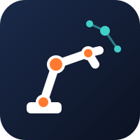
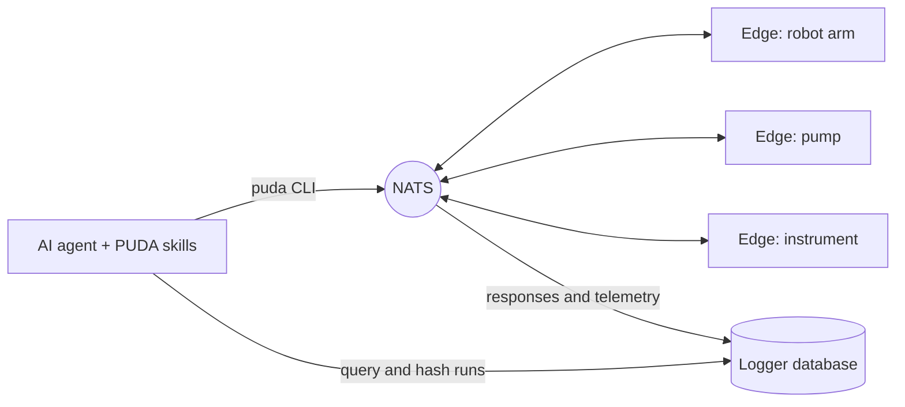

<div align="center">



<h1>PUDA</h1>

**The runtime environment for Physical AI.**

Let AI agents plan, run and record work on real machines — lab instruments, robot arms, pumps, sensors — with every run hashed for verifiable provenance.

[](https://github.com/PUDAP/puda/releases/latest)
[](https://pypi.org/project/puda/)
[](https://docs.puda.co)
[](LICENSE)
[](https://github.com/PUDAP/puda)

[Quick start](#quick-start) · [How it works](#how-it-works) · [Agent skills](#agent-skills) · [Under the hood](#under-the-hood) · [Repository layout](#repository-layout) · [Development](#development) · [Docs](https://docs.puda.co)

Built by [PUDAP](https://github.com/PUDAP) · [puda.co](https://www.puda.co) · [Paper](https://www.puda.co/blog/paper) · [MIT](LICENSE)

</div>

<table>
<tr>
<td width="25%" valign="top">

**Connect**<br>
Each machine runs a PUDA **edge** that wraps its driver and speaks NATS. `puda machine list` finds every edge on the network.

</td>
<td width="25%" valign="top">

**Plan**<br>
Your agent writes a protocol: JSON steps of atomic machine commands. `puda protocol validate` checks it before anything moves.

</td>
<td width="25%" valign="top">

**Run**<br>
`puda protocol run` executes step by step, in parallel where allowed, and stops on the first error. Risky steps wait for a `yes`.

</td>
<td width="25%" valign="top">

**Verify**<br>
Runs, samples and measurements are stored per project. `puda project hash` returns a deterministic SHA-256 of the dataset.

</td>
</tr>
</table>

**Headless by design, built for agents.** PUDA is a **hardware-agnostic**, **LLM-agnostic** platform with no bundled UI. You drive it with an AI agent — Cursor, Claude Code, Hermes Agent, OpenClaw or your own — using the [agent skills](skills/README.md) that ship in this repository: ready-made playbooks for setting up projects, writing protocols, running experiments and generating reports. When a human-facing view helps, ask your agent to build a dashboard (for example in Streamlit).

## Quick start

Install the CLI from the [latest release](https://github.com/PUDAP/puda/releases/latest) (Linux x86_64 shown; macOS, Windows and ARM builds are attached too):

```bash
curl -fsSL https://github.com/PUDAP/puda/releases/latest/download/puda_linux_x86_64.tar.gz \
  | tar -xz puda
sudo install puda /usr/local/bin/ && puda version
```

Give your agent the PUDA skills, then start a project:

```bash
puda skills install                        # release-pinned official skills
puda login -u <username>                   # name recorded with your runs
puda init ./my-project --name "My Project"
puda machine list                          # discover edges on your NATS profile
```

Or skip the typing and paste this into your agent:

```text
Install the latest PUDA CLI from https://github.com/PUDAP/puda/releases, add it to my PATH,
then install the PUDA skills with `puda skills install`.
```

Full setup — NATS server, edges, clock sync, security — is at **[docs.puda.co](https://docs.puda.co)**.

## How it works



1. **Edges** wrap each machine's driver and expose atomic commands plus telemetry over NATS.
2. **The CLI** is the single interface for agents: discover machines, run protocols, query data, check health. Most commands emit JSON (`--human` for text).
3. **Loggers** persist every command response and telemetry stream, so any run or time window can be retrieved later.
4. **Environments** isolate each lab's machines, drivers, data and credentials, so the same skills always load the right context.

## Agent skills

Skills live in [`skills/`](skills/README.md) and are versioned with the CLI. `puda skills install` installs the set matching your CLI release.

| Skill | What your agent learns |
|---|---|
| [`puda`](skills/puda) | Set up the CLI, projects and profiles; inspect machines |
| [`puda-protocol`](skills/puda-protocol) | Create, validate and run protocol JSON |
| [`puda-data`](skills/puda-data) | Extract, analyse, hash and report on run data |
| [`puda-database`](skills/puda-database) | Ad-hoc SQL and schema inspection on a project database |
| [`puda-deployment`](skills/puda-deployment) | Install, commission and troubleshoot edge deployments |
| [`puda-edge`](skills/puda-edge) | Build and update Python edge drivers for a new machine |
| [`puda-manual-ui`](skills/puda-manual-ui) | Build manual-control operator UIs |

Migrating from the old `PUDAP/skills` submodule? See the [skills migration guide](apps/cli/docs/skills-migration.md).

## Under the hood

| | |
|---|---|
| **NATS** | All message routing between components: one uniform, loosely coupled communication layer for every machine and service. |
| **Layered drivers and orchestration** | The control path separates how a device *works* from how experiments are *composed and executed*. |
| **CLI** | Versioned commands expose every capability, so agents use a stable interface instead of brittle one-off scripts. |
| **Environments** | Each environment's machines, drivers, data and credentials are isolated from every other. |
| **Verification** | Run data is extracted, SHA-256 hashed and stored, giving every run provenance from command to result. |

Design goals:

1. **Modularity** — driver, communication and orchestration layers are separate, so each can scale, change or be replaced independently.
2. **AI-native** — every capability is a stable, programmatic interface with atomic machine commands; agents are first-class operators, not an afterthought.
3. **Scalability** — from a single machine to a fleet of edges.

## Repository layout

```
puda/
├── apps/
│   ├── cli/            # Go CLI agents use to talk to PUDA
│   ├── docs/           # docs.puda.co source (Docusaurus, standalone pnpm project)
│   └── loadgen/        # Go load generator for NATS and fleet-scale tests
├── libs/
│   ├── python-sdk/     # Python SDK, published as `puda` on PyPI
│   └── db/             # PostgreSQL client (puda-db)
├── infra/
│   ├── nats/           # NATS server topologies and JetStream resources
│   └── chrony/         # Site NTP server; edge hosts sync to it
├── skills/             # Release-aligned agent skills
├── test-edge/          # Software-only edge for local testing
├── pyproject.toml      # uv workspace (Python)
└── package.json        # Nx workspace, installed with pnpm
```

Python packages share one uv workspace ([`pyproject.toml`](pyproject.toml)) whose members are `libs/*`, `services/*` and `test-edge`; there is no `services/` directory yet. Workspace packages reference each other locally:

```toml
[tool.uv.sources]
puda = { workspace = true }
```

The Go apps keep their own modules and are not part of `uv.lock`. The CLI checks each edge's reported `protocol_version`; see [Edge protocol compatibility](apps/cli/docs/compatibility.md).

## Development

**Prerequisites:** Python ≥ 3.12 and [uv](https://docs.astral.sh/uv/) · Go 1.26+ for `apps/cli` and `apps/loadgen` · Docker for the stacks under `infra/` · Node.js and pnpm for Nx.

```bash
uv sync                     # every Python workspace member in one venv
cd apps/cli && just build   # build the CLI
cd apps/docs && pnpm install && pnpm start   # docs site at localhost:3000 (Node ≥ 20)
```

- CLI commands and contracts: [`apps/cli/README.md`](apps/cli/README.md) · contributing: [`apps/cli/CONTRIBUTING.md`](apps/cli/CONTRIBUTING.md)
- Docs site: [`apps/docs/README.md`](apps/docs/README.md) — edit pages under `apps/docs/docs/`
- Test without hardware: [`test-edge/README.md`](test-edge/README.md)
- NATS layouts: [`infra/nats/README.md`](infra/nats/README.md)
- Security reports: [`SECURITY.md`](SECURITY.md)

## License

[MIT](LICENSE) © PUDAP
